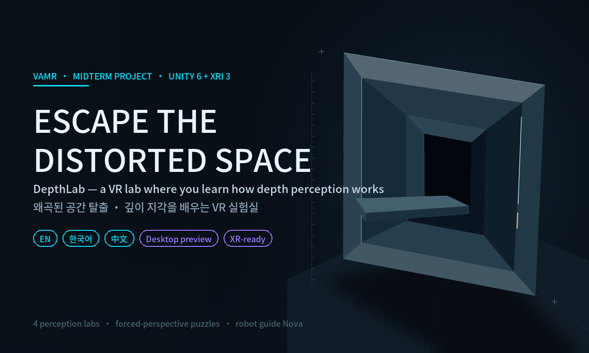
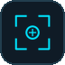
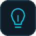
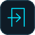
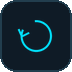
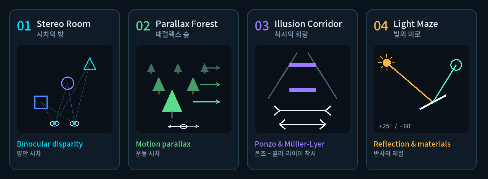
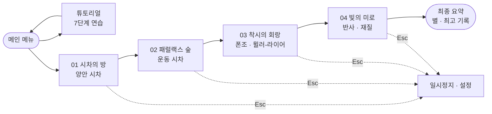
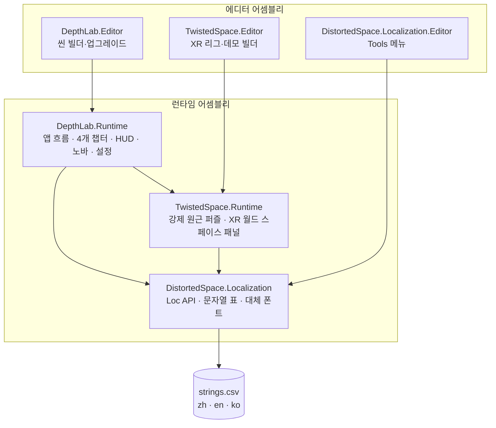

<p align="center">
  
</p>

<p align="center">
  <a href="README.md">English</a> · <b>한국어</b>
</p>

<p align="center">
  
  
  
  
  
  
</p>

**왜곡된 공간 탈출(Escape the Distorted Space)**은 **VAMR(가상·증강·혼합 현실)** 수업 중간 과제로 Unity 6에서 만든 VR 지각 실험실입니다.
짧은 실험실 네 곳을 차례로 지나가며, 뇌가 깊이를 판단할 때 쓰는 단서를 직접 손으로 푸는 퍼즐로 체험하고, 그 단서가 어떻게 속을 수 있는지도 확인합니다.

> [!NOTE]
> 현재 빌드는 **데스크톱 미리보기**입니다(Unity 에디터에서 키보드 + 마우스). VR 상호작용은 구현되어 있지만 아직 XR 로더를 설치해야 하며, [로드맵](#roadmap)의 첫 번째 작업입니다.

## ✨ 주요 특징

<table>
  <tr>
    <td width="64"></td>
    <td><b>직접 해 보며 배우기.</b> 양안 시차, 운동 시차, 폰조·뮐러-라이어 착시, 반사를 각각 손과 시점으로 푸는 퍼즐로 만들었습니다.</td>
  </tr>
  <tr>
    <td></td>
    <td><b>VR 우선 상호작용.</b> 머리를 따라오지 않는 월드 스페이스 UI, 눌러서 확정하는 버튼, 스냅 회전과 단계 이동, 머리 추적을 유지하는 일시정지.</td>
  </tr>
  <tr>
    <td></td>
    <td><b>로봇 가이드 노바.</b> 진행 상황과 실수에 반응하고, 요청하면 목표를 다시 알려 주며 힌트도 줍니다(힌트는 감점).</td>
  </tr>
  <tr>
    <td></td>
    <td><b>점수와 진행.</b> 시간, 실수, 힌트, 재시도로 실험실마다 별 최대 3개. 실험실은 순서대로 열리고 최고 기록이 저장됩니다.</td>
  </tr>
  <tr>
    <td></td>
    <td><b>3개 언어.</b> 검토하기 쉬운 <a href="Assets/Localization/Data/strings.csv">문자열 표</a> 하나로 English, 한국어, 中文 지원. 게임 중 <kbd>L</kbd>로 전환합니다.</td>
  </tr>
  <tr>
    <td></td>
    <td><b>반복 개발에 적합.</b> 에디터 씬 빌더, 테스트 파일 14개, 현지화용 <i>Report Untranslated Scene Text</i> 도구.</td>
  </tr>
</table>

## 🧪 네 개의 실험실

<p align="center"></p>

| # | 실험실 | 배우는 것 | 하는 일 |
|---|---|---|---|
| 01 | **시차의 방** | 양안 시차 | 서로 다른 세 깊이에 있는 와이어프레임 목표에 컬러 도형 세 개를 넣습니다. |
| 02 | **패럴랙스 숲** | 운동 시차 | 왼쪽, 오른쪽 순서로 관찰하면 가까운 나뭇잎이 먼 나뭇잎보다 많이 움직이며 숨은 발판 길이 드러납니다. |
| 03 | **착시의 회랑** | 폰조·뮐러-라이어 착시 | 두 정육면체와 두 선분이 정말 다른지 판단한 뒤, 배경이 왜 눈을 속였는지 확인합니다. |
| 04 | **빛의 미로** | 반사와 재질 | 광원을 맞추고 거울을 돌려 반사광이 수신기에 고정되게 합니다. |

전체 조작법과 공략(스포일러): **[플레이 방법](docs/ko/how-to-play.md)**.

## 🚀 빠른 시작

1. Unity Hub로 **Unity 6000.6.8f1**을 설치합니다(다른 버전은 프로젝트 업그레이드를 요구합니다).
2. 저장소를 클론합니다. **Windows에서는 `C:\dev\`처럼 짧은 경로에 클론하세요.** 프로젝트가 깊은 폴더 안에 있으면 Unity 패키지 경로가 260자 제한을 넘습니다.
   ```bash
   git clone https://github.com/VikaKumaChR/escape-the-wuuuut.git
   ```
3. Unity Hub › **Add › Add project from disk**로 폴더를 엽니다. 첫 임포트에는 몇 분이 걸립니다.
4. **`Assets/TwistedSpace/Demo/Scenes/ParallaxChamber.unity`**를 열고 **▶ Play**를 누른 뒤 **Game** 뷰 안을 클릭합니다.
5. <kbd>L</kbd>을 누르면 **English → 한국어 → 中文** 순으로 바뀝니다.

## 🎮 조작법

| 동작 | 데스크톱 미리보기 | VR(XR 설정 후) |
|---|---|---|
| 둘러보기 | <kbd>마우스 오른쪽</kbd> 유지 + 마우스 이동 | 머리 돌리기 |
| 이동 / 회전 | <kbd>W</kbd><kbd>A</kbd><kbd>S</kbd><kbd>D</kbd> / <kbd>Q</kbd><kbd>E</kbd> | 왼쪽 / 오른쪽 썸스틱 |
| 버튼 누르기 | <kbd>마우스 왼쪽</kbd> 클릭 | 레이 + 트리거 |
| 잡기·옮기기·놓기 | 컬러 물체 위에서 <kbd>마우스 왼쪽</kbd> 유지 · 휠 = 거리 | 그립 |
| 일시정지 | <kbd>Esc</kbd> | 왼쪽 메뉴 버튼 |
| 끼임 해제 / 언어 | <kbd>R</kbd> / <kbd>L</kbd> | — |

## 🧭 게임 흐름



## 🏗️ 구조



<details>
<summary><b>📁 프로젝트 구조</b></summary>

```text
Assets/
├─ DepthLab/          현재 게임: 앱 흐름, 4개 챕터, HUD, 노바 가이드, 설정
│  ├─ Runtime/        게임 플레이 스크립트          (DepthLab.Runtime)
│  ├─ Editor/         씬 빌더와 일회성 업그레이드 스크립트
│  ├─ Generated/      절차적으로 생성한 메시, 머티리얼, 오디오, 폰트 아틀라스
│  ├─ Nova/, UI/      프리팹
│  └─ Tests/          에디트 모드 테스트
├─ TwistedSpace/      초기 프로토타입: 강제 원근 퍼즐, XR 패널, 시뮬레이터 리그
├─ Localization/      영어·한국어·중국어 문자열 표와 런타임
├─ Samples/           XR Device Simulator 샘플(XRI 3.3.2)
└─ Scenes/            수정하지 않은 SampleScene
docs/                 2개 언어 문서(en/, ko/), 용어집, 이미지
```
</details>

## 🌐 언어

메뉴, HUD, 튜토리얼, 챕터 목표, 힌트, 노바의 대사까지 플레이어에게 보이는 모든 문자열을 **영어, 한국어, 중국어**로 제공합니다.
중국어가 원문(키)으로 유지되므로 씬은 하나도 바꿀 필요가 없었습니다. 한국어는 프로젝트에 포함된 Noto Sans CJK 폰트로 만든 동적 대체 폰트로 표시됩니다.
동작 방식과 번역 수정 방법: **[현지화 가이드](docs/ko/localization.md)**.

## ⚠️ 알려진 문제

- **XR 로더 없음** — OpenXR / XR Management가 설치되어 있지 않아 데스크톱 미리보기로만 실행됩니다.
- **Windows 경로 길이** — 프로젝트 폴더가 너무 깊으면 일부 에디터 창(Input Actions 편집기, Render Pipeline Converter)이 오류를 냅니다. 짧은 경로를 사용하세요.
- **오래된 테스트 1개** — `DoorLabelsDescribeLockedOpeningReadyPausedAndResetStates`가 예전 출구 문 문구를 기대하고 있습니다.
- **Unity Cloud 연결** — 프로젝트가 아직 원작자의 Unity Cloud 프로젝트에 연결되어 있어 시작할 때 무해한 403 오류가 기록됩니다.
- VR 이동 중 **편의용 비네트**가 아직 없습니다.
- Hierarchy의 오브젝트 이름은 스크립트가 이름으로 찾기 때문에 일부러 중국어로 두었습니다. [용어집](docs/glossary.md)을 참고하세요.

<a id="roadmap"></a>

## 🗺️ 로드맵

| 스프린트 | 기간(제안) | 중점 |
|---|---|---|
| 0 | 11/11 – 11/17 | 팀 온보딩: 번역, 문서, 한국어 검토 |
| 1 | 11/16 – 11/22 | 실제 VR: OpenXR, Meta Quest 프로필, 컨트롤러 테스트, 짧은 프로젝트 경로 |
| 2 | 11/23 – 11/29 | 설정의 언어 옵션, 영어·한국어 텍스트 맞춤 |
| 3 | 11/30 – 12/6 | 편의용 비네트, 테스트 수정, Quest 72fps |
| 4 | 12/7 – 12/13 | 플레이테스트, 최종 빌드, 데모 영상, 발표 자료 |

전체 백로그, 위험 요소, 팀원 검토 체크리스트: **[개발 계획](docs/ko/dev-plan.md)**.

## 📚 문서

| | English | 한국어 |
|---|---|---|
| 플레이 방법 | [how-to-play.md](docs/en/how-to-play.md) | [how-to-play.md](docs/ko/how-to-play.md) |
| 개발 계획 | [dev-plan.md](docs/en/dev-plan.md) | [dev-plan.md](docs/ko/dev-plan.md) |
| 현지화 | [localization.md](docs/en/localization.md) | [localization.md](docs/ko/localization.md) |
| Twisted Space 설정(프로토타입) | [twisted-space-setup.md](docs/en/twisted-space-setup.md) | [twisted-space-setup.md](docs/ko/twisted-space-setup.md) |
| Twisted Space 데모 가이드(프로토타입) | [twisted-space-demo-guide.md](docs/en/twisted-space-demo-guide.md) | [twisted-space-demo-guide.md](docs/ko/twisted-space-demo-guide.md) |
| 용어집(中文 · EN · 한국어) | [glossary.md](docs/glossary.md) | |

## 🙏 크레딧

- **아트** — PNG 텍스처, 아이콘, 오프닝 키 아트는 이 프로젝트를 위해 절차적으로 제작했습니다([크레딧](Assets/TwistedSpace/Demo/Art/CREDITS.txt)).
- **폰트** — Noto Sans CJK SC Medium, © Google / Adobe, [SIL Open Font License 1.1](Assets/TwistedSpace/Demo/Fonts/OFL.txt).
- **오디오** — 프로젝트 안에서 절차적으로 생성(`Assets/DepthLab/Generated`).
- **Unity 패키지** — URP, XR Interaction Toolkit(XR Device Simulator 샘플 포함), Input System, TextMeshPro.
- **팀** — 역할과 회의록은 팀 Notion 워크스페이스에서 관리합니다.
