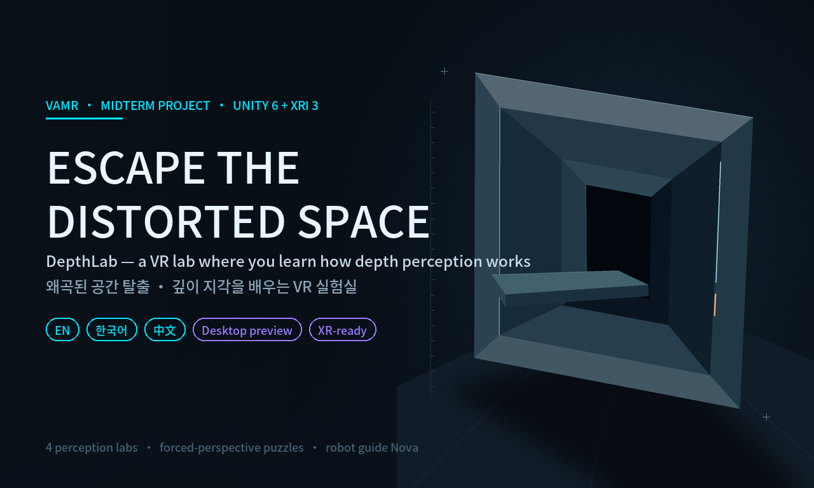
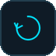
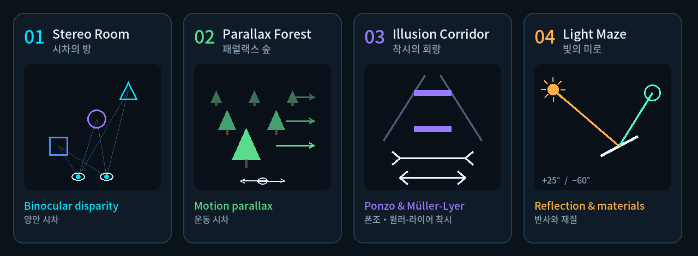
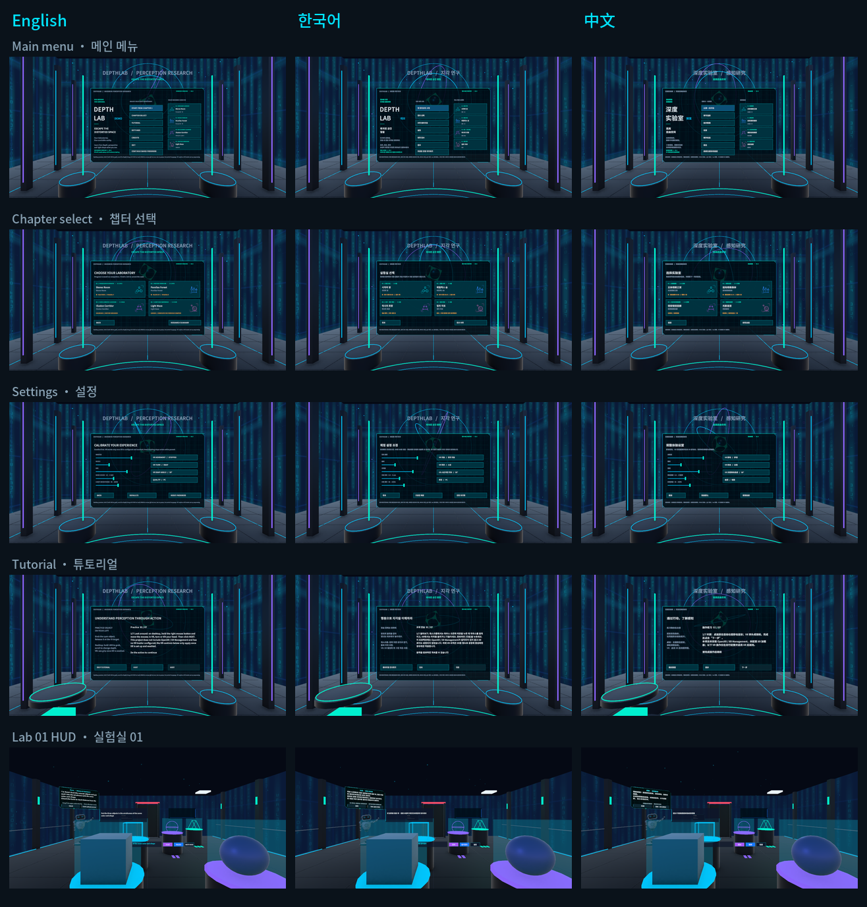
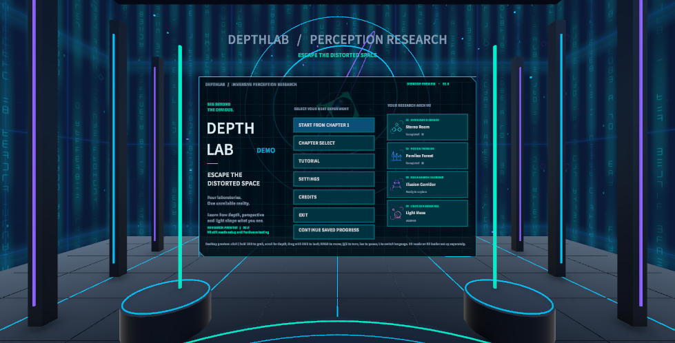
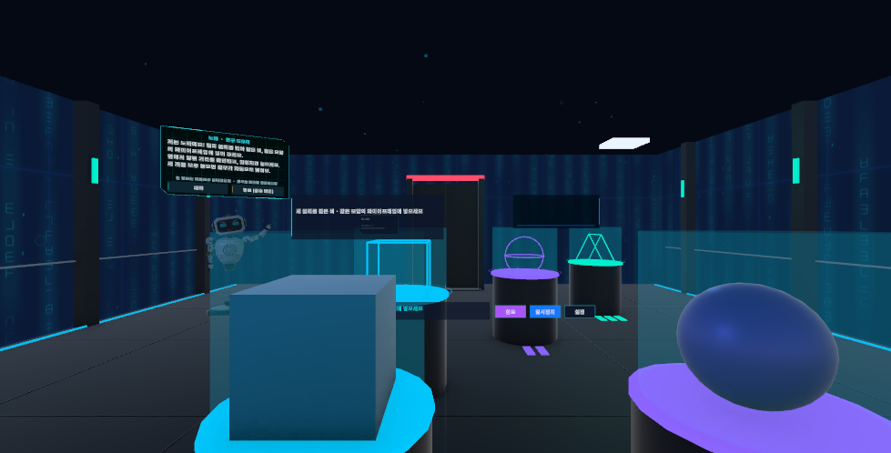
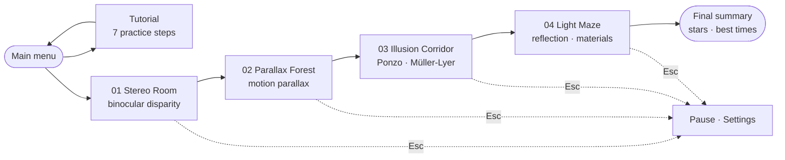
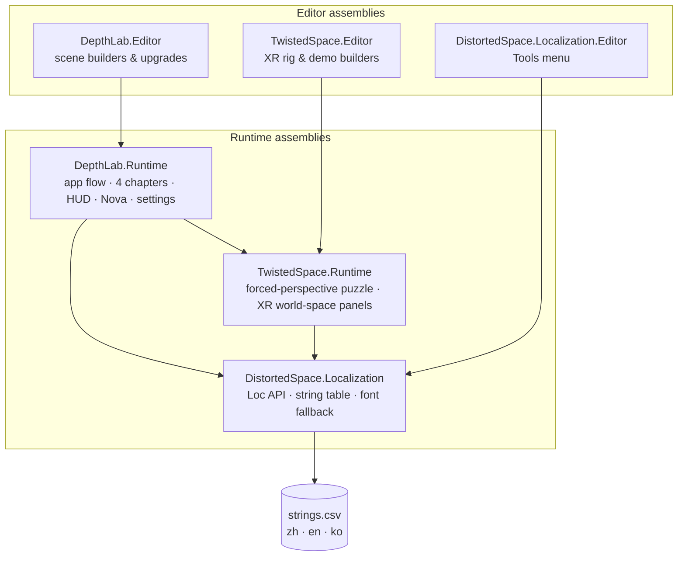

<p align="center">
  
</p>

<p align="center">
  <b>English</b> · <a href="README.ko.md">한국어</a>
</p>

<p align="center">
  
  
  
  
  
  
</p>

**Escape the Distorted Space** is a VR perception lab built in Unity 6 for the **VAMR (Virtual · Augmented · Mixed Reality)** midterm.
You walk through four short laboratories. Each one turns a depth cue your brain relies on into a hands-on puzzle — and then shows you how that cue can be fooled.

> [!NOTE]
> The current build is a **desktop preview** (keyboard + mouse in the Unity editor). The VR interaction is implemented, but an XR loader still has to be installed — that is the first item on the [roadmap](#roadmap).

## ✨ Highlights

<table>
  <tr>
    <td width="64"></td>
    <td><b>Learn by doing.</b> Binocular disparity, motion parallax, the Ponzo and Müller-Lyer illusions, and reflection — each becomes a puzzle you solve with your hands and your point of view.</td>
  </tr>
  <tr>
    <td></td>
    <td><b>VR-first interaction.</b> World-space UI that never follows your head, hold-to-confirm buttons, snap turn and stepped movement, and a pause that keeps head tracking alive.</td>
  </tr>
  <tr>
    <td></td>
    <td><b>Nova, the robot guide.</b> Reacts to your progress and mistakes, repeats the goal on request, and gives hints — which cost score.</td>
  </tr>
  <tr>
    <td></td>
    <td><b>Scoring and progress.</b> Up to 3 stars per lab from time, mistakes, hints and retries. Labs unlock in order and your best run is saved.</td>
  </tr>
  <tr>
    <td></td>
    <td><b>Three languages.</b> English, 한국어 and 中文 from one reviewable <a href="Assets/Localization/Data/strings.csv">string table</a>. Press <kbd>L</kbd> in game to switch.</td>
  </tr>
  <tr>
    <td></td>
    <td><b>Built to iterate.</b> Editor scene builders, 14 test files, and a <i>Report Untranslated Scene Text</i> tool for the localization.</td>
  </tr>
</table>

## 🧪 The four labs

<p align="center"></p>

| # | Lab | What you learn | What you do |
|---|---|---|---|
| 01 | **Stereo Room** | Binocular disparity | Put three colored shapes into wireframe targets that sit at three different depths. |
| 02 | **Parallax Forest** | Motion parallax | Look left, then right — near foliage moves more than far foliage — to reveal a hidden path of platforms. |
| 03 | **Illusion Corridor** | Ponzo & Müller-Lyer illusions | Judge whether two cubes and two lines really differ, then see why the background fooled you. |
| 04 | **Light Maze** | Reflection & materials | Aim a light and rotate a mirror until the reflected beam locks onto the receiver. |

Full controls and a spoiler walkthrough: **[How to Play](docs/en/how-to-play.md)**.

## 📸 Screenshots

The main screens in all three languages, captured in Unity with *Tools › Distorted Space › Localization › Capture UI Screenshots*:

<p align="center"></p>

<table>
  <tr>
    <td width="50%"></td>
    <td width="50%"></td>
  </tr>
  <tr>
    <td align="center">Main menu · English</td>
    <td align="center">Lab 01 · 한국어</td>
  </tr>
</table>

## 🚀 Quick start

1. Install **Unity 6000.6.8f1** with Unity Hub (other versions will ask to upgrade the project).
2. Clone the repository. **On Windows, clone into a short path** such as `C:\dev\` — Unity packages exceed the 260-character path limit when the project sits deep in nested folders.
   ```bash
   git clone https://github.com/VikaKumaChR/escape-the-wuuuut.git
   ```
3. Unity Hub › **Add › Add project from disk** and open the folder. The first import takes a few minutes.
4. Open **`Assets/TwistedSpace/Demo/Scenes/ParallaxChamber.unity`**, press **▶ Play**, then click inside the **Game** view.
5. Press <kbd>L</kbd> to cycle **English → 한국어 → 中文**.

## 🎮 Controls

| Action | Desktop preview | VR (after XR setup) |
|---|---|---|
| Look around | Hold <kbd>RMB</kbd> + move the mouse | Turn your head |
| Move / turn | <kbd>W</kbd><kbd>A</kbd><kbd>S</kbd><kbd>D</kbd> / <kbd>Q</kbd><kbd>E</kbd> | Left / right thumbstick |
| Press buttons | <kbd>LMB</kbd> click | Ray + trigger |
| Grab, move, drop | Hold <kbd>LMB</kbd> on a colored object · scroll wheel = depth | Grip |
| Pause | <kbd>Esc</kbd> | Left menu button |
| Unstuck / language | <kbd>R</kbd> / <kbd>L</kbd> | — |

## 🧭 Game flow



## 🏗️ Architecture



<details>
<summary><b>📁 Project structure</b></summary>

```text
Assets/
├─ DepthLab/          active game: app flow, 4 chapters, HUD, Nova guide, settings
│  ├─ Runtime/        gameplay scripts            (DepthLab.Runtime)
│  ├─ Editor/         scene builders and one-off upgrade scripts
│  ├─ Generated/      procedurally generated meshes, materials, audio, font atlases
│  ├─ Nova/, UI/      prefabs
│  └─ Tests/          edit-mode tests
├─ TwistedSpace/      original prototype: forced-perspective puzzle, XR panels, simulator rig
├─ Localization/      EN / KO / ZH string table and runtime
├─ Samples/           XR Device Simulator sample (XRI 3.3.2)
└─ Scenes/            untouched SampleScene
docs/                 bilingual documentation (en/, ko/), glossary, images
```
</details>

## 🌐 Languages

Every player-facing string — menus, HUD, tutorial, chapter goals, hints and Nova's lines — is available in **English, Korean and Chinese**.
Chinese stays the source text, so nothing in the scenes had to change. Korean text renders through a dynamic fallback built from the bundled Noto Sans CJK font.
How it works and how to edit translations: **[Localization guide](docs/en/localization.md)**.

## ⚠️ Known issues

- **No XR loader yet** — OpenXR / XR Management are not installed, so the build runs as a desktop preview.
- **Windows path length** — a deeply nested project folder breaks some editor windows (Input Actions editor, Render Pipeline Converter). Use a short path.
- **Pre-existing test failures** — EditMode 172/195 and PlayMode 19/61 pass. Every failure already happens on the original import (verified by running both suites before and after the localization); see T12 and T19 in the [dev plan](docs/en/dev-plan.md).
- **Unity Cloud link** — the project is still linked to the original author's Unity Cloud project, which logs a harmless 403 on startup.
- **No comfort vignette** during VR locomotion yet.
- Hierarchy object names stay in Chinese on purpose (scripts look them up by name); see the [glossary](docs/glossary.md).

<a id="roadmap"></a>

## 🗺️ Roadmap

| Sprint | Dates (proposed) | Focus |
|---|---|---|
| 0 | Nov 11 – 17 | Team onboarding: translations, docs, Korean review |
| 1 | Nov 16 – 22 | Real VR: OpenXR, Meta Quest profile, controller test, short project path |
| 2 | Nov 23 – 29 | Language option in Settings, text fitting for EN/KO |
| 3 | Nov 30 – Dec 6 | Comfort vignette, test fixes, 72 fps on Quest |
| 4 | Dec 7 – 13 | Playtests, final build, demo video, slides |

Full backlog, risks and the teammate review checklist: **[Development plan](docs/en/dev-plan.md)**.

## 📚 Documentation

| | English | 한국어 |
|---|---|---|
| How to play | [how-to-play.md](docs/en/how-to-play.md) | [how-to-play.md](docs/ko/how-to-play.md) |
| Development plan | [dev-plan.md](docs/en/dev-plan.md) | [dev-plan.md](docs/ko/dev-plan.md) |
| Localization | [localization.md](docs/en/localization.md) | [localization.md](docs/ko/localization.md) |
| Twisted Space setup (prototype) | [twisted-space-setup.md](docs/en/twisted-space-setup.md) | [twisted-space-setup.md](docs/ko/twisted-space-setup.md) |
| Twisted Space demo guide (prototype) | [twisted-space-demo-guide.md](docs/en/twisted-space-demo-guide.md) | [twisted-space-demo-guide.md](docs/ko/twisted-space-demo-guide.md) |
| Glossary (中文 · EN · 한국어) | [glossary.md](docs/glossary.md) | |

## 🙏 Credits

- **Art** — PNG textures, icons and the opening key art were procedurally authored for this project ([credits](Assets/TwistedSpace/Demo/Art/CREDITS.txt)).
- **Font** — Noto Sans CJK SC Medium, © Google / Adobe, [SIL Open Font License 1.1](Assets/TwistedSpace/Demo/Fonts/OFL.txt).
- **Audio** — procedurally generated in the project (`Assets/DepthLab/Generated`).
- **Unity packages** — URP, XR Interaction Toolkit (including the XR Device Simulator sample), Input System, TextMeshPro.
- **Team** — roles and meeting notes live in the team's Notion workspace.
