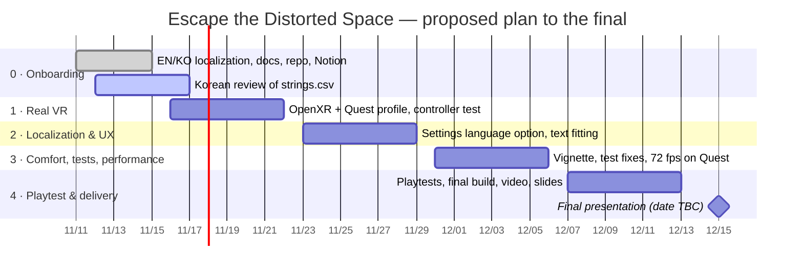

# Development Plan — from midterm prototype to final

🌐 **English** · [한국어](../ko/dev-plan.md)

> [!IMPORTANT]
> Dates are a **proposal** based on a mid-December final. Confirm them against the official course schedule at the next team meeting, then assign owners in Notion.

## Where we are (2026-11-11)

| Area | Status |
|---|---|
| Gameplay | ✅ 4 labs, tutorial, scoring, saving, Nova guide — playable on desktop |
| Languages | ✅ English / 한국어 / 中文 (press **L**) — Korean needs a native review |
| VR | ⚠️ Controls are implemented, but **no XR loader** is installed (no OpenXR / XR Management) |
| Comfort | ⚠️ Snap turn and stepped movement exist; **no vignette** yet |
| Tests | ⚠️ 14 test files; one door-label test still expects an old label and is expected to fail |
| Tooling | ⚠️ The project path on Windows exceeds 260 characters, which breaks some editor windows |

## Timeline

## Backlog

| ID | Task | Area | Priority | Sprint | Done when |
|---|---|---|---|---|---|
| T01 | Native review of the Korean column in `strings.csv` | Localization | P0 | 0 | Reviewer signs off; fixes merged |
| T02 | Play all 4 labs in EN and KO; screenshot any overflowing text (*Capture UI Screenshots* covers the menus automatically) | QA | P0 | 0 | Issue list posted in Notion |
| T03 | Agree on roles, meeting cadence and review flow | Team | P1 | 0 | Roles filled in Notion |
| T04 | Move the project to a short path (e.g. `E:\VAMR\Midterm-VAMR`) or enable Windows long paths | Tooling | P0 | 1 | No "Could not find a part of the path" errors in `Editor.log` |
| T05 | Unlink the old Unity Cloud project (403 in the log) or link it to the team's org | Tooling | P2 | 1 | No Unity Connect 403 on startup |
| T06 | Install **XR Plug-in Management + OpenXR**, add the Meta Quest profile and Android target | VR | P0 | 1 | Scene runs on a headset (Quest Link or standalone) |
| T07 | Verify mappings: grip = grab, trigger + ray = UI, sticks = move/turn, menu = pause | VR | P0 | 1 | All 4 labs completed in VR |
| T08 | Add a language selector to **Settings** (the L key does not exist in VR) | Localization | P1 | 2 | Language changeable from the headset |
| T09 | Fix EN/KO text overflow (TMP auto-size or layout tweaks) | UI | P1 | 2 | No clipped labels in T02 screenshots |
| T10 | Optional: bake Hangul into a static atlas for builds | Localization | P2 | 2 | No runtime font atlas generation in builds |
| T11 | Comfort **vignette** during locomotion | Comfort | P1 | 3 | Vignette toggle in Settings |
| T12 | Update `DoorLabelsDescribeLockedOpeningReadyPausedAndResetStates` to the current door label | QA | P1 | 3 | Test passes |
| T13 | Run all EditMode/PlayMode tests and record the results | QA | P1 | 3 | Test report in Notion |
| T14 | Profile on Quest and hold **72 fps** | Performance | P1 | 3 | Frame time ≤ 13.9 ms in all labs |
| T15 | Merge the one-off `*Upgrade.cs` / `*Repair.cs` editor scripts into one builder | Code health | P2 | 3 | One menu rebuilds the scene |
| T16 | Playtest with 5+ people; log time, mistakes, hints (already recorded by the game) | Research | P0 | 4 | Results table + 3 key findings |
| T17 | Final build, demo video, screenshots/GIFs in the README | Delivery | P0 | 4 | Build + video uploaded |
| T18 | Final presentation slides (EN, with KO speaker notes) | Delivery | P0 | 4 | Rehearsed once |

**Priorities:** P0 = required for the final · P1 = strongly recommended · P2 = nice to have.

## Risks

| Risk | Mitigation |
|---|---|
| No headset available for testing | Book a lab headset early; Quest Link on a PC; keep the desktop preview as a fallback demo |
| Windows long paths break editor tools and Android builds | T04 in Sprint 1, before any build work |
| New Chinese strings added without translations | Run *Tools › Distorted Space › Localization › Report Untranslated Scene Text* before each merge |
| Large binary files (16.5 MB font, audio) slow down the repo | Adopt Git LFS if the repository grows past ~200 MB |
| Knowledge concentrated in one person | Keep docs and Notion pages current; review each other's PRs |

## Teammate review checklist

- [ ] Read the [README](../../README.md) and the [How to Play](how-to-play.md) guide.
- [ ] Open the project in **Unity 6000.6.8f1** and press Play in `ParallaxChamber.unity`.
- [ ] Switch to Korean with **L** and finish the tutorial plus at least one lab.
- [ ] Note unnatural Korean (row number + suggestion) in `strings.csv` or in Notion.
- [ ] Note any clipped or overflowing text with a screenshot.
- [ ] Comment on the plan above: dates, priorities, who takes which task.

## Working agreement (proposal)

- **Branches:** `main` stays playable; work on `feature/<topic>` branches and open a pull request.
- **Reviews:** at least one teammate approves each pull request.
- **Commits:** short English summary line; Korean or Chinese details are welcome in the body.
- **Unity:** never commit `Library/`, `Temp/`, `Logs/` or `UserSettings/` (already in `.gitignore`); always commit `.meta` files.
