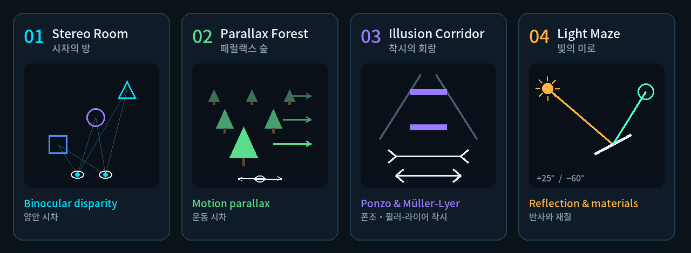

# How to Play

🌐 **English** · [한국어](../ko/how-to-play.md)

*Escape the Distorted Space* is a VR perception lab. Four short laboratories each teach one way your brain judges depth — and how that judgement can be fooled.
The current build is a **desktop preview**: you play with keyboard and mouse in the Unity editor. VR controls are already implemented but need an XR loader (see the [dev plan](dev-plan.md)).

## ▶️ Start

1. Open the scene **`Assets/TwistedSpace/Demo/Scenes/ParallaxChamber.unity`** (it is the first scene in *Build Settings*).
2. Press **▶ Play**, then **click once inside the Game view** — the game only receives input while the Game view has focus.
3. On the main menu, pick **TUTORIAL** for the 7-step practice, or start the first lab.
4. Press **L** at any time to switch the language: **English → 한국어 → 中文**. Your choice is remembered.

## 🎮 Controls

| Action | Desktop preview | VR (once XR is set up) |
|---|---|---|
| Look around | **Hold right mouse button** + move the mouse | Turn your head |
| Move | **W A S D** | Left thumbstick (stepped or smooth — see Settings) |
| Turn | **Q / E** | Right thumbstick (snap or smooth) |
| Press a button | **Left click** | Point the ray + trigger |
| Grab an object | **Hold left mouse button** on a colored object, drag, release to drop | Grip |
| Push / pull a held object | **Scroll wheel** | Move your hand |
| Pause | **Esc** | Left-hand menu button |
| Get unstuck (return to a safe spot) | **R** | — |
| Switch language | **L** | — |

> [!TIP]
> **Colored objects are solid** and can be grabbed. **Wireframes are only targets** (holograms without collision) — you cannot grab them, and they will not hold an object up.

## 🧪 The four labs (walkthrough — spoilers!)

| # | Lab | Depth cue | Goal |
|---|---|---|---|
| 01 | **Stereo Room** · 시차의 방 | Binocular disparity | Put the **blue cube**, **violet sphere** and **cyan triangular prism** into the wireframe with the same shape and color. The targets sit at three different depths — look from the side to judge distance. |
| 02 | **Parallax Forest** · 패럴랙스 숲 | Motion parallax | Click **LOOK LEFT**, wait for the view to settle, then **LOOK RIGHT**. Near foliage moves more than far foliage, revealing hidden platforms. Click the glowing platforms **01 → 04** in order (a wrong pick sends you back to the last checkpoint). |
| 03 | **Illusion Corridor** · 착시의 회랑 | Ponzo & Müller-Lyer illusions | Two questions, both answered **"same"**: the cubes are the **SAME SIZE**, and the middle lines are the **SAME LENGTH**. Click **CONTINUE** after each explanation. |
| 04 | **Light Maze** · 빛의 미로 | Reflection & materials | Click **+25°** to set the light, then click **MIRROR −5°** nine times (−15° → −60°) until the beam hits the orange receiver. Hold still for 1.5 s until it lights up. |

After each lab the exit door opens — **walk through it** to finish the chapter. Finishing a lab unlocks the next one, and the final summary shows your stars and best times.

## ⭐ Scoring

- Every **mistake**, **hint** and **retry** adds one penalty point.
- **3 ★** needs a fast time *and* few penalty points; **2 ★** is a little more lenient; otherwise you get **1 ★**. Thresholds are set per chapter.
- Your **best run** per chapter is saved automatically (more stars, or the same stars with a faster time). *Settings › Reset progress* clears it.

## 🤖 Nova, the research assistant

Nova floats beside you in each lab. **Talk** repeats the current objective; **Hint** gives a targeted tip (and counts as a hint for scoring). Nova also reacts when you place an object, make a mistake or finish a lab.

## 🧩 Looking for the original prototype?

The first prototype, *Twisted Space — Parallax Observatory*, is still in the project (disabled in the main scene). Its controls and design notes are in the [demo guide](twisted-space-demo-guide.md) and [setup guide](twisted-space-setup.md).
