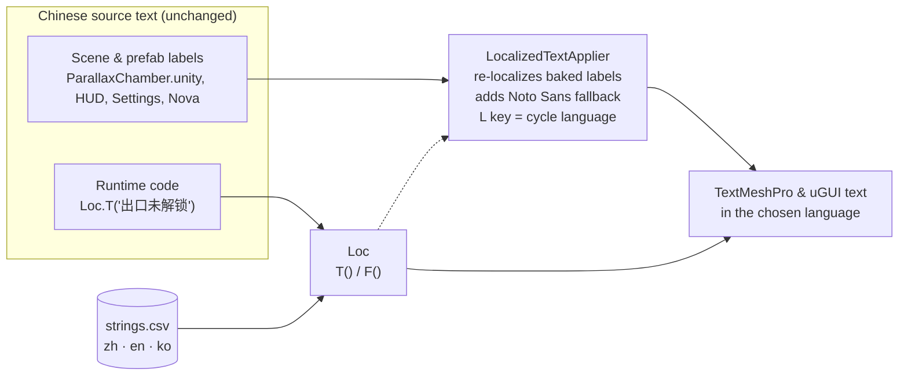

# Localization (English · 한국어 · 中文)

🌐 **English** · [한국어](../ko/localization.md)

The game was originally written in Chinese. This update adds **English and Korean** without changing gameplay, scenes or prefabs.
All translations live in one spreadsheet-style file that teammates can review directly on GitHub:

**📄 [`Assets/Localization/Data/strings.csv`](../../Assets/Localization/Data/strings.csv)** — 415 rows, columns `zh, en, ko, context`.

## How it works

1. **The Chinese text is the key.** Code calls `Loc.T("出口未解锁")` and gets `EXIT LOCKED`, `출구 잠김` or `出口未解锁`. Strings with numbers use a format key: `Loc.F("进度  {0}/{1}", progress, goal)`.
2. **Labels baked into scenes and prefabs** keep their Chinese text on disk. At runtime, `LocalizedTextApplier` (created automatically, no scene wiring) finds every TextMeshPro and uGUI text and swaps in the current language, on scene load, when the language changes, and twice a second for newly shown UI.
3. **Korean glyphs:** the baked SDF atlases only contain the characters of the original UI. The applier builds a *dynamic* TextMeshPro fallback from the bundled **Noto Sans CJK** font (which covers all 11,172 Hangul syllables) and attaches it to the fonts in use, so Korean never renders as □ boxes.
4. **Choosing the language:** first run → Korean on a Korean OS, Chinese on a Chinese OS, otherwise English. After that, the player's last choice is saved (`PlayerPrefs` key `DistortedSpace.Language`).
   - In game: press **L** (a small toast confirms the language).
   - In the editor: **Tools › Distorted Space › Language**.

## Editing translations

1. Open `strings.csv` in any spreadsheet app or text editor (UTF-8).
2. Change the `en` or `ko` cell. **Never edit the `zh` column** — it must match the text in code and scenes exactly.
3. Keep placeholders identical to the Chinese key: `{0}`, `{1:00}`, `{0:0.0}` …
4. Line breaks are written as `\n` inside a cell.
5. In the editor run **Tools › Distorted Space › Localization › Reload String Table**, or just re-enter Play Mode.

An empty `ko` cell falls back to English; an empty `en` cell falls back to the Chinese key.

## Adding a new string

- **In code:** write the Chinese (or any) source text and wrap it: `label.text = Loc.T("新的提示");`, then add a row to `strings.csv` with the same key.
- **In a scene/prefab label:** type the source text into the TextMeshPro component and add the matching row. Nothing else is needed.
- Use **Tools › Distorted Space › Localization › Report Untranslated Scene Text** to list every Chinese label in the open scene that has no row yet.

## What is intentionally *not* translated

| Item | Why |
|---|---|
| GameObject names in the Hierarchy (e.g. `出口能量框`, `开始探索`) | Editor scripts and tests look these objects up **by name**. Renaming them would break the builders. Their meanings are listed in the [glossary](../glossary.md). |
| Chinese text inside editor *generator* scripts (`Assets/DepthLab/Editor/*Upgrade.cs`, `DemoUIBuilder.cs`, …) | These scripts write the scene's source text. Their labels are already in `strings.csv`, so re-generated UI stays translated. Developer-facing menu names and log messages in them were translated to English. |
| `DepthLabProgress.Titles`, tutorial steps and other Chinese arrays | They are keys; they are displayed through `Loc.T(...)`. |

## Files

| Path | Purpose |
|---|---|
| `Assets/Localization/Runtime/Loc.cs` | Public API: `T`, `F`, `SetLanguage`, `Cycle`, `Current`, `LanguageChanged` |
| `Assets/Localization/Runtime/LocalizedTextApplier.cs` | Scene-label re-localization, Noto Sans fallback, **L** key, language toast |
| `Assets/Localization/Runtime/LocalizationSettings.cs` | ScriptableObject that points at the table and the fallback font |
| `Assets/Localization/Resources/DistortedSpaceLocalization.asset` | The settings instance (loaded with `Resources.Load`) |
| `Assets/Localization/Data/strings.csv` | The string table |
| `Assets/Localization/Editor/LocalizationMenu.cs` | *Tools › Distorted Space* menu |

The DepthLab edit-mode tests force Chinese in `DepthLabPlayerPrefsFixture`, so their existing Chinese assertions keep working without touching the player's saved language.
