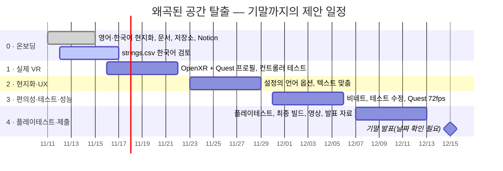

# 개발 계획 — 중간 프로토타입에서 기말까지

🌐 [English](../en/dev-plan.md) · **한국어**

> [!IMPORTANT]
> 일정은 12월 중순 기말 발표를 가정한 **제안안**입니다. 다음 팀 회의에서 공식 수업 일정과 맞춰 확정하고, Notion에서 담당자를 정해 주세요.

## 현재 상태(2026-11-11)

| 영역 | 상태 |
|---|---|
| 게임 플레이 | ✅ 실험실 4개, 튜토리얼, 점수, 저장, 노바 가이드 — 데스크톱에서 플레이 가능 |
| 언어 | ✅ English / 한국어 / 中文(**L** 키) — 한국어는 원어민 검토 필요 |
| VR | ⚠️ 조작은 구현되어 있지만 **XR 로더가 설치되지 않음**(OpenXR / XR Management 없음) |
| 편의성 | ⚠️ 스냅 회전과 단계 이동은 있으나 **비네트 없음** |
| 테스트 | ⚠️ 테스트 파일 14개, 출구 문 라벨 테스트 하나는 예전 문구를 기대하고 있어 실패가 예상됨 |
| 개발 환경 | ⚠️ Windows에서 프로젝트 경로가 260자를 넘어 일부 에디터 창이 오류를 냄 |

## 일정

## 백로그

| ID | 작업 | 영역 | 우선순위 | 스프린트 | 완료 기준 |
|---|---|---|---|---|---|
| T01 | `strings.csv` 한국어 열 원어민 검토 | 현지화 | P0 | 0 | 검토자 승인, 수정 사항 반영 |
| T02 | 영어·한국어로 4개 실험실 모두 플레이, 넘치는 텍스트 캡처(*Capture UI Screenshots*가 메뉴 화면을 자동 캡처) | QA | P0 | 0 | Notion에 이슈 목록 등록 |
| T03 | 역할, 회의 주기, 리뷰 방식 합의 | 팀 | P1 | 0 | Notion에 역할 기입 |
| T04 | 프로젝트를 짧은 경로(예: `E:\VAMR\Midterm-VAMR`)로 옮기거나 Windows 긴 경로 지원 켜기 | 개발 환경 | P0 | 1 | `Editor.log`에 "Could not find a part of the path" 오류 없음 |
| T05 | 예전 Unity Cloud 프로젝트 연결 해제(로그의 403) 또는 팀 조직에 연결 | 개발 환경 | P2 | 1 | 시작 시 Unity Connect 403 없음 |
| T06 | **XR Plug-in Management + OpenXR** 설치, Meta Quest 프로필과 Android 타깃 추가 | VR | P0 | 1 | 헤드셋에서 씬 실행(Quest Link 또는 단독) |
| T07 | 매핑 확인: 그립 = 잡기, 트리거 + 레이 = UI, 스틱 = 이동/회전, 메뉴 = 일시정지 | VR | P0 | 1 | VR로 4개 실험실 완료 |
| T08 | **설정**에 언어 선택 추가(VR에는 L 키가 없음) | 현지화 | P1 | 2 | 헤드셋에서 언어 변경 가능 |
| T09 | 영어·한국어 텍스트 넘침 수정(TMP 자동 크기 또는 레이아웃 조정) | UI | P1 | 2 | T02 캡처에서 잘린 라벨 없음 |
| T10 | 선택: 빌드용 정적 아틀라스에 한글 굽기 | 현지화 | P2 | 2 | 빌드에서 런타임 폰트 아틀라스 생성 없음 |
| T11 | 이동 중 편의용 **비네트** | 편의성 | P1 | 3 | 설정에서 비네트 켜고 끄기 |
| T12 | `DoorLabelsDescribeLockedOpeningReadyPausedAndResetStates` 테스트를 현재 출구 문구에 맞게 수정 | QA | P1 | 3 | 테스트 통과 |
| T13 | EditMode/PlayMode 테스트 전체 실행 및 결과 기록 | QA | P1 | 3 | Notion에 테스트 보고 |
| T14 | Quest에서 프로파일링, **72fps** 유지 | 성능 | P1 | 3 | 모든 실험실에서 프레임 시간 ≤ 13.9ms |
| T15 | 일회성 `*Upgrade.cs` / `*Repair.cs` 에디터 스크립트를 하나의 빌더로 통합 | 코드 품질 | P2 | 3 | 메뉴 하나로 씬 재구성 |
| T16 | 5명 이상 플레이테스트, 시간·실수·힌트 기록(게임이 이미 기록함) | 연구 | P0 | 4 | 결과 표 + 핵심 발견 3가지 |
| T17 | 최종 빌드, 데모 영상, README 스크린샷/GIF | 제출 | P0 | 4 | 빌드와 영상 업로드 |
| T18 | 기말 발표 자료(영어, 한국어 발표 메모 포함) | 제출 | P0 | 4 | 리허설 1회 |

**우선순위:** P0 = 기말에 필수 · P1 = 강력 권장 · P2 = 있으면 좋음.

## 위험 요소

| 위험 | 대응 |
|---|---|
| 테스트할 헤드셋이 없음 | 학과 헤드셋을 미리 예약, PC에서 Quest Link 사용, 데스크톱 미리보기를 대체 데모로 유지 |
| Windows 긴 경로로 에디터 도구와 Android 빌드가 실패 | 빌드 작업 전 1번 스프린트에서 T04 처리 |
| 번역 없이 새 중국어 문자열이 추가됨 | 병합 전에 *Tools › Distorted Space › Localization › Report Untranslated Scene Text* 실행 |
| 큰 바이너리 파일(16.5MB 폰트, 오디오)로 저장소가 느려짐 | 저장소가 약 200MB를 넘으면 Git LFS 도입 |
| 지식이 한 사람에게 집중됨 | 문서와 Notion을 최신으로 유지, 서로의 PR 리뷰 |

## 팀원 검토 체크리스트

- [ ] [README](../../README.ko.md)와 [플레이 방법](how-to-play.md)을 읽는다.
- [ ] **Unity 6000.6.8f1**로 프로젝트를 열고 `ParallaxChamber.unity`에서 Play를 누른다.
- [ ] **L** 키로 한국어로 바꾸고, 튜토리얼과 실험실을 최소 하나 끝까지 플레이한다.
- [ ] 어색한 한국어는 `strings.csv`나 Notion에 적는다(행 번호 + 제안 문구).
- [ ] 잘리거나 넘치는 텍스트는 스크린샷과 함께 적는다.
- [ ] 위 계획(일정, 우선순위, 담당 작업)에 의견을 남긴다.

## 협업 규칙(제안)

- **브랜치:** `main`은 항상 플레이 가능한 상태로 유지하고, 작업은 `feature/<주제>` 브랜치에서 한 뒤 풀 리퀘스트를 연다.
- **리뷰:** 모든 풀 리퀘스트는 팀원 최소 1명의 승인을 받는다.
- **커밋:** 요약 줄은 짧은 영어로, 본문에는 한국어나 중국어 설명도 환영한다.
- **Unity:** `Library/`, `Temp/`, `Logs/`, `UserSettings/`는 커밋하지 않는다(이미 `.gitignore`에 있음). `.meta` 파일은 항상 커밋한다.
