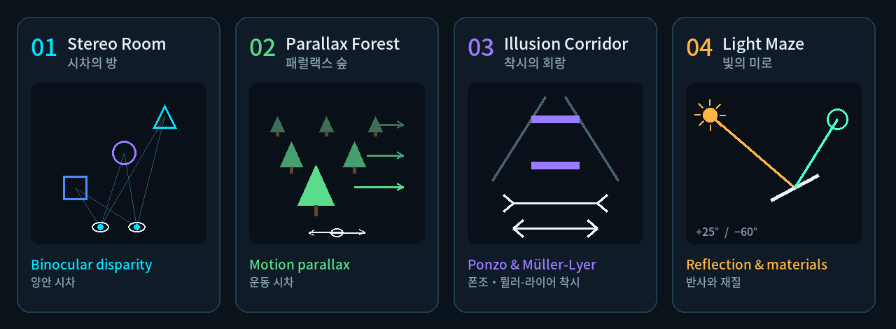

# 플레이 방법

🌐 [English](../en/how-to-play.md) · **한국어**

*왜곡된 공간 탈출(Escape the Distorted Space)*은 VR 지각 실험실입니다. 짧은 실험실 네 곳에서 뇌가 깊이를 판단하는 방법을 하나씩 배우고, 그 판단이 어떻게 속을 수 있는지 직접 확인합니다.
현재 빌드는 **데스크톱 미리보기**입니다. Unity 에디터에서 키보드와 마우스로 플레이합니다. VR 조작은 이미 구현되어 있지만 XR 로더 설정이 필요합니다([개발 계획](dev-plan.md) 참고).

## ▶️ 시작하기

1. **`Assets/TwistedSpace/Demo/Scenes/ParallaxChamber.unity`** 씬을 엽니다(*Build Settings*의 첫 번째 씬입니다).
2. **▶ Play**를 누른 뒤 **Game 뷰 안을 한 번 클릭**하세요. Game 뷰에 포커스가 있을 때만 입력이 전달됩니다.
3. 메인 메뉴에서 7단계 연습인 **조작 튜토리얼**을 고르거나, 첫 번째 실험실을 바로 시작합니다.
4. 언제든 **L**을 누르면 언어가 **English → 한국어 → 中文** 순으로 바뀝니다. 선택한 언어는 저장됩니다.

## 🎮 조작법

| 동작 | 데스크톱 미리보기 | VR(XR 설정 후) |
|---|---|---|
| 둘러보기 | **마우스 오른쪽 버튼 유지** + 마우스 이동 | 머리 돌리기 |
| 이동 | **W A S D** | 왼쪽 썸스틱(단계 이동/연속 이동 — 설정에서 변경) |
| 회전 | **Q / E** | 오른쪽 썸스틱(스냅/연속) |
| 버튼 누르기 | **왼쪽 클릭** | 레이로 가리키고 트리거 |
| 물체 잡기 | 컬러 물체 위에서 **왼쪽 버튼을 누른 채** 드래그, 떼면 내려놓기 | 그립 |
| 잡은 물체 앞뒤 이동 | **마우스 휠** | 손 움직이기 |
| 일시정지 | **Esc** | 왼손 메뉴 버튼 |
| 끼었을 때 안전 위치로 복귀 | **R** | — |
| 언어 전환 | **L** | — |

> [!TIP]
> **컬러 물체는 실체**라서 잡을 수 있습니다. **와이어프레임은 목표 표시일 뿐**(충돌 없는 홀로그램)이라 잡을 수 없고, 물체를 받쳐 주지도 않습니다.

## 🧪 네 실험실(공략 — 스포일러 주의!)

| # | 실험실 | 깊이 단서 | 목표 |
|---|---|---|---|
| 01 | **시차의 방** · Stereo Room | 양안 시차 | **파란 정육면체**, **보라색 구**, **청록색 삼각기둥**을 같은 모양·같은 색의 와이어프레임에 넣으세요. 목표는 서로 다른 세 깊이에 있으니 옆에서 보며 거리를 판단하세요. |
| 02 | **패럴랙스 숲** · Parallax Forest | 운동 시차 | **[왼쪽 보기]**를 누르고 시점이 멈출 때까지 기다린 뒤 **[오른쪽 보기]**를 누르세요. 가까운 나뭇잎이 먼 나뭇잎보다 더 많이 움직이면서 숨은 발판이 드러납니다. 빛나는 발판을 **01 → 04** 순서대로 누르세요(잘못 고르면 가장 가까운 체크포인트로 돌아갑니다). |
| 03 | **착시의 회랑** · Illusion Corridor | 폰조·뮐러-라이어 착시 | 두 질문의 답은 모두 **"같다"**입니다. 정육면체는 **[크기 같음]**, 가운데 선분은 **[길이 같음]**. 설명을 읽은 뒤 매번 **[계속]**을 누르세요. |
| 04 | **빛의 미로** · Light Maze | 반사와 재질 | **[+25°]**를 눌러 광원을 맞춘 뒤, 빛이 주황색 수신 구체에 닿을 때까지 **[거울 −5°]**를 아홉 번 누르세요(−15° → −60°). 1.5초 동안 그대로 기다리면 불이 켜집니다. |

실험이 끝나면 출구 문이 열립니다. **문을 걸어서 통과**하면 챕터가 완료됩니다. 실험실을 마칠 때마다 다음 실험실이 열리고, 최종 요약 화면에서 별과 최고 기록을 확인할 수 있습니다.

## ⭐ 점수

- **실수**, **힌트**, **재시도**는 각각 감점 1점입니다.
- **별 3개**는 빠른 시간 *그리고* 적은 감점이 모두 필요하고, **별 2개**는 조금 더 너그럽습니다. 그 외에는 **별 1개**입니다. 기준은 챕터마다 다릅니다.
- 챕터별 **최고 기록**은 자동으로 저장됩니다(별이 더 많거나, 별 수가 같으면 더 빠른 기록). *설정 › 진행 초기화*로 지울 수 있습니다.

## 🤖 연구 도우미 노바

노바는 각 실험실에서 옆에 떠 있습니다. **[대화]**는 현재 목표를 다시 알려 주고, **[힌트]**는 상황에 맞는 조언을 줍니다(점수에서는 힌트로 계산됩니다). 물체를 놓거나, 실수하거나, 실험을 끝내면 노바가 반응합니다.

## 🧩 초기 프로토타입이 궁금하다면

첫 프로토타입인 *Twisted Space — 시차 관측실*은 프로젝트에 그대로 남아 있습니다(메인 씬에서는 비활성화). 조작법과 설계 메모는 [데모 가이드](twisted-space-demo-guide.md)와 [설정 가이드](twisted-space-setup.md)에 있습니다.
