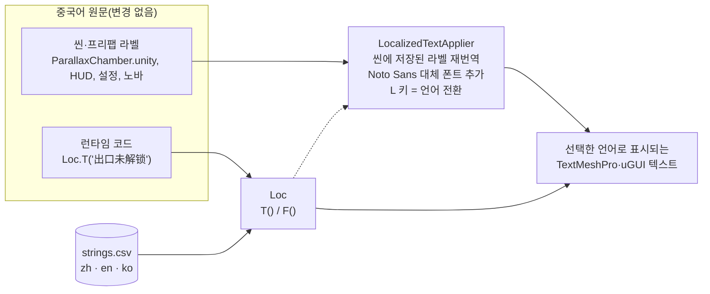

# 현지화(English · 한국어 · 中文)

🌐 [English](../en/localization.md) · **한국어**

이 게임은 원래 중국어로 작성되었습니다. 이번 업데이트에서는 게임 플레이, 씬, 프리팹을 바꾸지 않고 **영어와 한국어**를 추가했습니다.
모든 번역은 팀원이 GitHub에서 바로 검토할 수 있는 표 형식 파일 하나에 들어 있습니다.

**📄 [`Assets/Localization/Data/strings.csv`](../../Assets/Localization/Data/strings.csv)** — 415행, 열은 `zh, en, ko, context`.

## 동작 방식

1. **중국어 원문이 키입니다.** 코드에서 `Loc.T("出口未解锁")`를 호출하면 `EXIT LOCKED`, `출구 잠김`, `出口未解锁` 중 하나가 반환됩니다. 숫자가 들어가는 문장은 서식 키를 사용합니다: `Loc.F("进度  {0}/{1}", progress, goal)`.
2. **씬·프리팹에 저장된 라벨**은 디스크에 중국어 그대로 남아 있습니다. 런타임에 `LocalizedTextApplier`(자동 생성, 씬 연결 불필요)가 모든 TextMeshPro·uGUI 텍스트를 찾아 현재 언어로 바꿉니다. 씬을 불러올 때, 언어를 바꿀 때, 그리고 새로 나타나는 UI를 위해 0.5초마다 실행됩니다.
3. **한글 글리프:** 미리 구운 SDF 아틀라스에는 원래 UI에 쓰인 글자만 들어 있습니다. 그래서 프로젝트에 포함된 **Noto Sans CJK** 폰트(한글 음절 11,172자 전체 포함)로 *동적* TextMeshPro 대체 폰트를 만들어 사용 중인 폰트에 연결합니다. 한국어가 □ 상자로 깨지지 않습니다.
4. **언어 결정 순서:** 처음 실행하면 OS가 한국어일 때 한국어, 중국어일 때 중국어, 그 외에는 영어로 시작합니다. 이후에는 마지막으로 고른 언어가 저장됩니다(`PlayerPrefs` 키 `DistortedSpace.Language`).
   - 게임 안에서: **L** 키(언어 이름이 잠시 표시됩니다).
   - 에디터에서: **Tools › Distorted Space › Language**.

## 번역 수정하기

1. `strings.csv`를 스프레드시트 앱이나 텍스트 편집기(UTF-8)로 엽니다.
2. `en` 또는 `ko` 칸을 수정합니다. **`zh` 열은 절대 수정하지 마세요.** 코드와 씬의 텍스트와 정확히 일치해야 합니다.
3. 자리표시자는 중국어 키와 똑같이 유지합니다: `{0}`, `{1:00}`, `{0:0.0}` 등.
4. 칸 안의 줄바꿈은 `\n`으로 적습니다.
5. 에디터에서 **Tools › Distorted Space › Localization › Reload String Table**을 실행하거나, Play Mode를 다시 시작합니다.

`ko` 칸이 비어 있으면 영어가, `en` 칸이 비어 있으면 중국어 키가 표시됩니다.

## 새 문자열 추가하기

- **코드에서:** 원문을 쓰고 감싸 주세요: `label.text = Loc.T("新的提示");` 그다음 같은 키로 `strings.csv`에 행을 추가합니다.
- **씬/프리팹 라벨에서:** TextMeshPro 컴포넌트에 원문을 입력하고 같은 키의 행을 추가하면 끝입니다.
- **Tools › Distorted Space › Localization › Report Untranslated Scene Text**를 실행하면, 열려 있는 씬에서 아직 행이 없는 중국어 라벨을 모두 보여 줍니다.

## 화면에서 번역 검토하기

**Tools › Distorted Space › Localization › Capture UI Screenshots (EN · KO · ZH)**를 실행하면 메인 씬을 플레이하면서 메인 메뉴, 챕터 선택, 설정, 튜토리얼, 실험실 01 화면을 영어·한국어·중국어로 각각 찍어 `docs/images/screens/`에 스크린샷 15장을 저장합니다.
게임을 끝까지 플레이하지 않아도 잘리거나 넘치는 텍스트를 찾을 수 있습니다. 명령줄에서는 `Unity.exe -projectPath <프로젝트> -executeMethod DepthLab.Editor.DepthLabLanguageScreenshots.CaptureAndQuit`로 실행합니다.

## 의도적으로 번역하지 *않은* 것

| 항목 | 이유 |
|---|---|
| Hierarchy의 GameObject 이름(예: `出口能量框`, `开始探索`) | 에디터 스크립트와 테스트가 이 오브젝트를 **이름으로** 찾습니다. 이름을 바꾸면 빌더가 깨집니다. 의미는 [용어집](../glossary.md)에 정리했습니다. |
| 에디터 *생성기* 스크립트 안의 중국어(`Assets/DepthLab/Editor/*Upgrade.cs`, `DemoUIBuilder.cs` 등) | 씬의 원문을 만들어 내는 스크립트입니다. 이 라벨들도 `strings.csv`에 들어 있어서 다시 생성한 UI도 번역됩니다. 개발자용 메뉴 이름과 로그 메시지는 영어로 바꿨습니다. |
| `DepthLabProgress.Titles`, 튜토리얼 단계 등 중국어 배열 | 키로 사용되며, `Loc.T(...)`를 거쳐 표시됩니다. |

## 파일 구성

| 경로 | 역할 |
|---|---|
| `Assets/Localization/Runtime/Loc.cs` | 공개 API: `T`, `F`, `SetLanguage`, `Cycle`, `Current`, `LanguageChanged` |
| `Assets/Localization/Runtime/LocalizedTextApplier.cs` | 씬 라벨 재번역, Noto Sans 대체 폰트, **L** 키, 언어 알림 |
| `Assets/Localization/Runtime/LocalizationSettings.cs` | 문자열 표와 대체 폰트를 가리키는 ScriptableObject |
| `Assets/Localization/Resources/DistortedSpaceLocalization.asset` | 설정 인스턴스(`Resources.Load`로 로드) |
| `Assets/Localization/Data/strings.csv` | 문자열 표 |
| `Assets/Localization/Editor/LocalizationMenu.cs` | *Tools › Distorted Space* 메뉴 |
| `Assets/DepthLab/Editor/DepthLabLanguageScreenshots.cs` | 주요 화면을 세 언어로 캡처 |

DepthLab 에디트 모드 테스트는 `DepthLabPlayerPrefsFixture`에서 언어를 중국어로 고정합니다. 그래서 기존의 중국어 검증이 그대로 동작하며, 플레이어가 저장한 언어 설정은 건드리지 않습니다.
